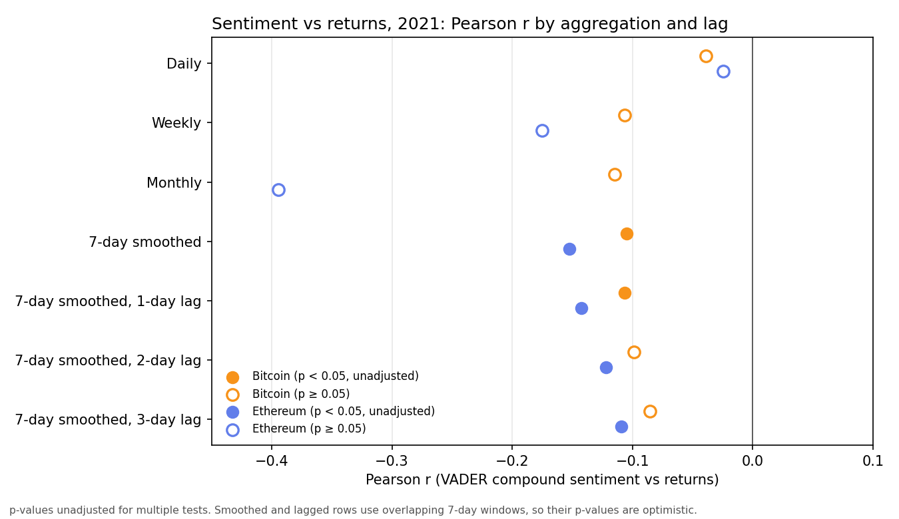
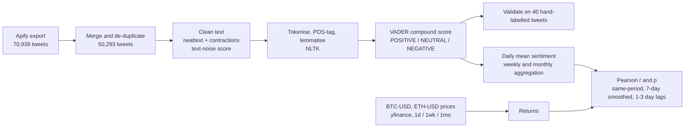
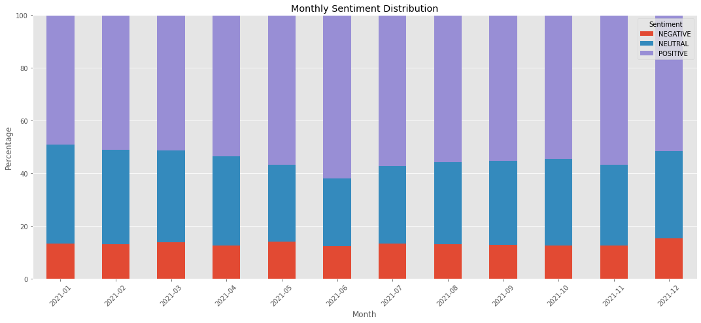
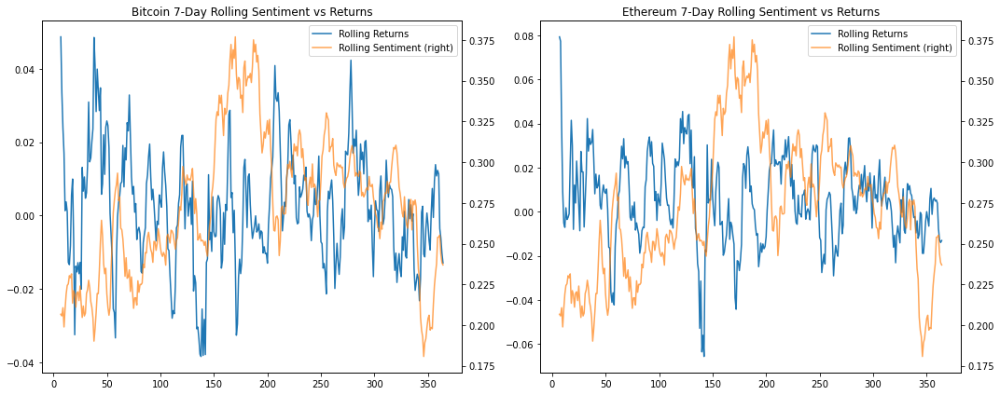

# Twitter Sentiment vs Bitcoin and Ethereum Prices (2021)


**50,293 tweets from 2021, cleaned and lemmatised with NLTK, scored with VADER, and correlated with BTC-USD and ETH-USD returns at daily, weekly and monthly scales, with 7-day smoothing and 1–3 day lags. No significant same-period relationship; weak negative correlations appear only after smoothing or lagging, clearest for Ethereum. Correlation, not causation.**

Individual research project · King's College London · Postgraduate Certificate (PGCert) Advanced Computing · May–Aug 2023

| **50,293** | **85.00%** | **3 scales** |
|:--:|:--:|:--:|
| Bitcoin and Ethereum tweets from 2021 | VADER accuracy on 40 hand-labelled tweets (34/40) | daily, weekly, monthly, plus 7-day smoothing and 1–3 day lags |

## Research question

Does public Twitter sentiment track Bitcoin and Ethereum price movements across 2021?

## Findings

- **No significant same-period relationship.** Daily (n = 364), weekly (n = 53) and monthly (n = 12) Pearson correlations between mean VADER sentiment and returns are all negative and none is significant (smallest p = 0.2044).
- **Weak negative correlations appear only after smoothing or lagging, strongest for Ethereum:** 7-day smoothed r = −0.152 (p < 0.01) and one-day lag r = −0.143 (p < 0.01). Bitcoin is marginal (p = 0.0470 and 0.0446). These tests use overlapping windows and no multiple-comparison adjustment, so they are exploratory.
- **VADER matched the hand labels on 34 of 40 tweets (85.00%),** but only 3 of the 40 are negative and an always-positive baseline scores 72.50%. See [Limitations](#limitations).



## Data

| Source | Content | In this repository |
|---|---|---|
| Tweets | 50,293 Bitcoin and Ethereum tweets posted in 2021, collected with Apify | Tweet IDs, timestamps and scores only (`data/derived/`) |
| Hand labels | 40 tweets sampled at random (`random_state=42`) and labelled manually | IDs, VADER label and human label (`data/annotation/`) |
| Prices | BTC-USD and ETH-USD, daily / weekly / monthly, 2021, from Yahoo Finance via `yfinance` | Yes (`data/prices/`) |
| Tweet counts | Daily counts for the top 8 Bitcoin and Ethereum hashtags, 144,157–1,011,392 per day | Yes (`data/tweet_counts/`) |

**Collection.** The first attempt used `snscrape`, which stopped working after Twitter restricted scraping; it is kept as a record in notebook 01. Tweets were then collected with the Apify scraping platform. The Apify actor and query settings are not recorded in the notebooks. The raw export held 70,938 tweets; removing 20,645 rows with duplicate text left 50,293. The corpus holds 90–169 tweets per day (median 139): a roughly constant-size daily sample that says nothing about tweet volume. Notebook 09 uses the separate count file for volume.

**What is not redistributed, and why.** Tweet text, user names and tweet URLs are not in this repository. Tweet text is user content under X's terms, and [X's developer policy](https://docs.x.com/developer-terms/policy) limits redistribution of X content to identifiers such as Post IDs. The repository therefore ships IDs plus the scores computed from the text. The user name and full name columns of the raw export were dropped in notebook 02, before any analysis. Details are in [`data/README.md`](data/README.md).

## Pipeline



**Cleaning and scoring.** neattext and `contractions` remove emails, hashtags, user handles, HTML tags, URLs, numbers, phone numbers, currency symbols and repeated whitespace, and expand contractions. NLTK removes stop words, tokenises, POS-tags and lemmatises. VADER scores the lemmatised text; a tweet is POSITIVE if its compound score is above 0, NEGATIVE if below 0 and NEUTRAL if exactly 0. Each tweet also gets a neattext text-noise score (punctuation, stop-word, emoji and URL counts per character, as a percentage) before and after cleaning.

**Returns and aggregation.** Returns are simple percentage changes of the daily close. Weekly (week ending Friday) and monthly returns are sums of daily returns; weekly and monthly sentiment is the mean of the daily mean compound score. Tweet timestamps are UTC and are matched to price bars by calendar date. The 7-day series are rolling means of both sentiment and returns; lags shift the smoothed sentiment series by 1–3 days.

| # | Notebook | What it does | Runs from a clone? |
|--:|---|---|---|
| 01 | [`01_snscrape_attempt`](notebooks/01_snscrape_attempt.ipynb) | First collection attempt (blocked) | Record only |
| 02 | [`02_merge_apify_exports`](notebooks/02_merge_apify_exports.ipynb) | Merge daily exports, remove duplicates | No: needs raw text |
| 03 | [`03_price_data_yfinance`](notebooks/03_price_data_yfinance.ipynb) | Download BTC-USD and ETH-USD prices | Needs network |
| 04 | [`04_text_cleaning_and_vader`](notebooks/04_text_cleaning_and_vader.ipynb) | Cleaning, lemmatisation, text-noise score, VADER | No: needs raw text |
| 05 | [`05_vader_validation`](notebooks/05_vader_validation.ipynb) | Precision, recall and accuracy on 40 hand labels | Yes |
| 06 | [`06_sentiment_visualisation`](notebooks/06_sentiment_visualisation.ipynb) | Monthly sentiment mix, compound-score time series | Yes |
| 07 | [`07_price_eda`](notebooks/07_price_eda.ipynb) | BTC and ETH price, volume and return exploration | Yes |
| 08 | [`08_correlation_sentiment_vs_returns`](notebooks/08_correlation_sentiment_vs_returns.ipynb) | Main correlation analysis | Yes (see Reproducibility) |
| 09 | [`09_correlation_tweet_volume_vs_returns`](notebooks/09_correlation_tweet_volume_vs_returns.ipynb) | Tweet volume vs returns | Yes |

## Results

### Sentiment distribution

| Label | Tweets | Share |
|---|--:|--:|
| Positive | 27,405 | 54.49% |
| Neutral | 16,188 | 32.19% |
| Negative | 6,700 | 13.32% |

The negative share stays between 12.44% and 15.25% in every month. The positive share ranges from 49.16% (January) to 61.97% (June). Monthly counts are in [`results/sentiment_distribution.csv`](results/sentiment_distribution.csv).



### VADER validation (40 hand-labelled tweets)

| Class | Precision | Recall | Hand-labelled | VADER-predicted |
|---|--:|--:|--:|--:|
| Positive | 96.30% (26/27) | 89.66% (26/29) | 29 | 27 |
| Neutral | 85.71% (6/7) | 75.00% (6/8) | 8 | 7 |
| Negative | 33.33% (2/6) | 66.67% (2/3) | 3 | 6 |
| **Overall accuracy** | **85.00% (34/40)** | | 40 | 40 |

Confusion matrix (rows: hand label; columns: VADER):

| | Positive | Neutral | Negative |
|---|--:|--:|--:|
| **Positive** | 26 | 1 | 2 |
| **Neutral** | 0 | 6 | 2 |
| **Negative** | 1 | 0 | 2 |

An always-positive classifier would score 29/40 = 72.50% on this sample. Negative-class precision (33.33%) rests on 6 predicted and 3 true negatives.

### Correlation: sentiment vs returns

Pearson r (p) between mean daily VADER compound score and returns. Full table with sample sizes: [`results/correlation_summary.csv`](results/correlation_summary.csv).

**Same-period, by aggregation**

| Test | n | Bitcoin r (p) | Ethereum r (p) |
|---|--:|--:|--:|
| Daily | 364 | −0.039 (0.4575) | −0.025 (0.6412) |
| Weekly (week ending Friday) | 53 | −0.106 (0.4485) | −0.175 (0.2103) |
| Monthly | 12 | −0.115 (0.7221) | −0.394 (0.2044) |

**7-day smoothing, lags and volatility**

| Test | n | Bitcoin r (p) | Ethereum r (p) |
|---|--:|--:|--:|
| 7-day smoothed | 358 | −0.105 (0.0470) | −0.152 (0.0039) |
| 7-day smoothed, sentiment lagged 1 day | 357 | −0.106 (0.0446) | −0.143 (0.0069) |
| 7-day smoothed, sentiment lagged 2 days | 356 | −0.099 (0.0623) | −0.122 (0.0211) |
| 7-day smoothed, sentiment lagged 3 days | 355 | −0.086 (0.1070) | −0.109 (0.0395) |
| Sentiment vs 7-day volatility of returns | 358 | −0.083 (0.1162) | −0.064 (0.2257) |



### Secondary analysis: tweet volume vs returns

Notebook 09 correlates the daily tweet-count file with returns (not sentiment). Higher-count days coincide with lower Ethereum returns at daily and weekly scale; Bitcoin is not significant at 5%. The monthly correlations rest on 12 points and are not interpreted.

| Test | n | Bitcoin r (p) | Ethereum r (p) |
|---|--:|--:|--:|
| Daily | 364 | −0.065 (0.2132) | −0.123 (0.0192) |
| Weekly (week ending Friday) | 52 | −0.238 (0.0892) | −0.320 (0.0208) |

## Limitations

- **Small validation sample.** The 85.00% accuracy comes from 40 tweets: 29 positive, 8 neutral, 3 negative. The always-positive baseline is 72.50%. The notebooks record a single hand label per tweet, so inter-annotator agreement was not measured.
- **VADER is a general-purpose English lexicon,** not finance- or crypto-specific, and the notebooks contain no language-detection step. Negative-class precision is weak (33.33%).
- **One combined sentiment series.** Tweets cover Bitcoin- and Ethereum-related terms together and were not split by coin, so the same daily series is correlated with both coins.
- **Overlapping windows and multiple tests.** The 7-day smoothed and lagged correlations use overlapping rolling windows, so consecutive observations are not independent and the p-values are optimistic. No multiple-comparison adjustment was applied to the 46 Pearson tests in notebooks 08 and 09.
- **Month-by-month correlations are not interpreted.** Notebook 08 also computes them at tweet level, pairing every tweet with that day's return (about 4,200 pairs from about 30 daily returns per month). All 24 have |r| < 0.05 and their p-values are not meaningful.
- **Edge effect in the weekly series.** The first weekly point (1 January) is a one-day bin whose return sums to 0.0, which makes n = 53. Dropping it moves weekly r to −0.116 (Bitcoin) and −0.194 (Ethereum); neither is significant (p = 0.4121 and 0.1691).
- **Scope.** One year, two coins, a constant-size daily sample of tweets. Correlation is not causation, and nothing here is a trading signal.
- **Data quality.** 90 tweets reduce to empty text after cleaning and score as neutral (compound 0.0). 90 tweets repeat an earlier tweet's text once whitespace is normalised and were retained.

## What came next

This project used a general-purpose lexicon and in-sample correlation. The MSc dissertation at Brunel University London (2024–25), [`news-stock-prediction`](https://github.com/AshishMenghani27/news-stock-prediction), addresses its limits (a small validation set, weak negative-class precision, no out-of-sample test): FinBERT in place of VADER, and walk-forward classification of next-day index direction (AUC-PR up to 0.587) in place of correlation. The same lexicon-plus-Pearson approach applied to COVID-19-era data is in [`covid-sentiment-stocks`](https://github.com/AshishMenghani27/covid-sentiment-stocks).

## Reproducibility

```bash
python -m venv .venv && source .venv/bin/activate      # Python 3.9-3.11
pip install -r requirements.txt
python scripts/make_results_tables.py                   # regenerates results/*.csv and the summary figure
jupyter lab                                             # then run notebooks 05 -> 09 in order
```

- **Verified.** Notebooks 05–09 were re-executed from the committed files in a clean Python 3.11 environment (versions in `requirements.txt`). 20 of the 22 cells with text output match the stored outputs to six decimals, including the sentiment split, the validation metrics, the main correlation table, the 7-day, lag and volatility results, and the tweet-volume table.
- **Two exceptions.** The month-by-month correlation tables in notebook 08 shift in the third decimal when re-run on the text-free file (for example January Bitcoin r = −0.0350 stored, −0.0343 re-run). The original code drops every row with a missing value in any column, including the text columns that are not redistributed. Stored outputs are from the original run on the full dataset, which reproduces them exactly.
- **Not re-run.** Notebooks 01, 02 and 04 need the raw tweets. Notebook 03 needs network access and Yahoo may have revised its history since 2023.
- **Rebuilding the text.** The IDs in `data/derived/` can be looked up through X's official API, subject to X's current terms and your access tier. Deleted or protected posts will not be retrievable, and re-collected text will not reproduce the exact cleaned corpus.
- **Plotly.** The candlestick charts at the end of notebook 07 are interactive and do not render on GitHub.

## Repository layout

```
crypto-twitter-sentiment-2021/
├── notebooks/             9 notebooks, paths sanitised, outputs that showed tweet text cleared
├── data/
│   ├── derived/           tweet IDs, timestamps, noise scores, VADER compound and label (no text)
│   ├── annotation/        40 IDs with VADER label and human label (no text)
│   ├── prices/            BTC-USD and ETH-USD, 1d / 1wk / 1mo, 2021
│   ├── tweet_counts/      daily counts for the top 8 hashtags
│   └── README.md          data dictionary and redistribution notes
├── results/
│   ├── correlation_summary.csv, vader_validation.csv, sentiment_distribution.csv
│   └── figures/           exported charts
├── scripts/
│   ├── make_results_tables.py    recompute the tables from committed data
│   ├── make_derived_data.py      how the text-free files were produced (needs the private data)
│   └── check_no_tweet_text.py    pre-push check that no tweet text is in the repo
├── requirements.txt
├── LICENSE
└── README.md
```

## Licence and data notice

Code is released under the [MIT licence](LICENSE). Tweet content is not covered by that licence and is not redistributed. Prices come from Yahoo Finance and remain subject to its terms.

## Academic context

Individual research project, King's College London, 2023.
